<p align="center">
  
</p>

<h1 align="center">Aries</h1>

<p align="center">A React workspace framework with a design system, an app shell, a full demo, and a starter template.</p>

<p align="center"><a href="README.md">简体中文</a> | <strong>English</strong></p>

<p align="center">
  <a href="https://github.com/marismoon/aries/actions/workflows/ci.yml"></a>
  
  
  
  
  
  
  <a href="LICENSE"></a>
</p>

<p align="center">
  <a href="#quick-start">Quick start</a> ·
  <a href="#documentation">Documentation</a> ·
  <a href="docs/ARCHITECTURE.md">Architecture</a> ·
  <a href="docs/STARTER.md">Create an app from Starter</a> ·
  <a href="AGENTS.md">Development contract</a>
</p>

| Light overview | Dark overview |
| --- | --- |
| 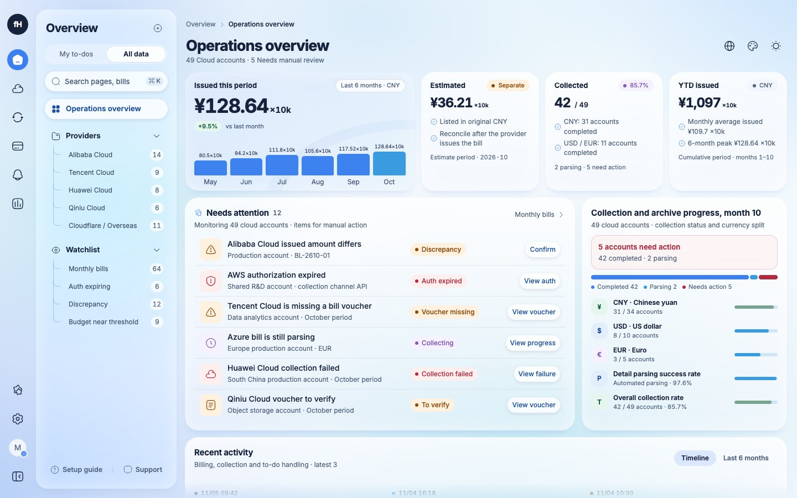 | 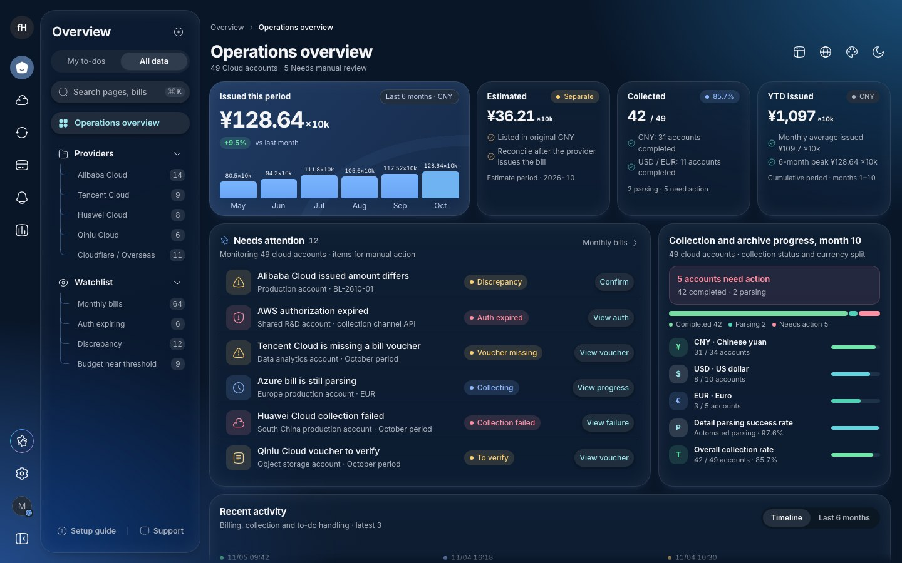 |

The Demo overview in the default brand palette, shown in light mode and dark glass mode.

## Overview and features

Aries provides the shared components and application shell for building workspaces. Demo uses local mock data to show the overview, billing, and component screens. Starter supplies a home page and a settings page wired into the same shell.

- **Brand palettes.** Five built-in palettes (Telemedicine blue, Calm mist blue, Warm terracotta, Fresh grass green, Amber sand), Telemedicine blue by default. Switch them from the page header in light or dark mode.
- **Modes and surfaces.** Use light or dark mode, with glass and clean options for dark mode.
- **Components and icons.** Build with shadcn-based components and Solar icons. Demo includes a component showcase.
- **Tables and charts.** Review billing records in a TanStack Table and explore metric trends in Recharts.
- **Workspace shell.** The three-column layout contains module shortcuts, workspace navigation, and page content. The command palette finds pages in the current module and opens available entries.
- **Two languages.** The workspace shell and primary Demo pages support Simplified Chinese and English.
- **Copilot demo.** The assistant panel answers sample questions using local mock data.
- **Starter.** A template with a home page and a settings page. Create apps from it with `pnpm create:app` or `npm create @marismoon/aries`; a layout contract protects the shell.

## Previews

<table>
  <tr>
    <td>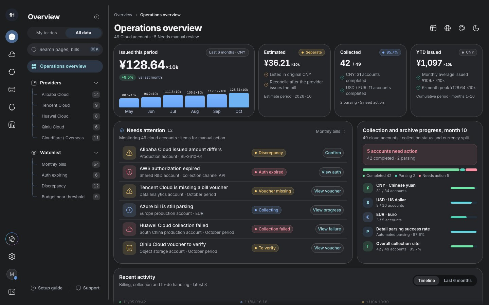<br>Overview in clean dark mode.</td>
    <td>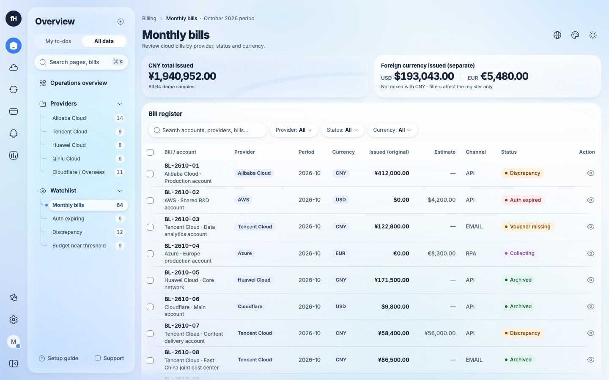<br>Monthly bills in a TanStack data table.</td>
  </tr>
  <tr>
    <td>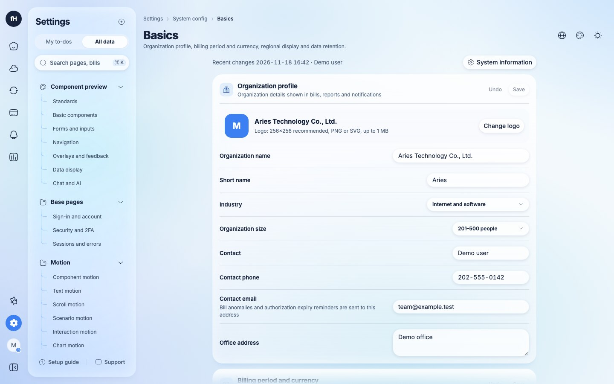<br>Basic information settings.</td>
    <td>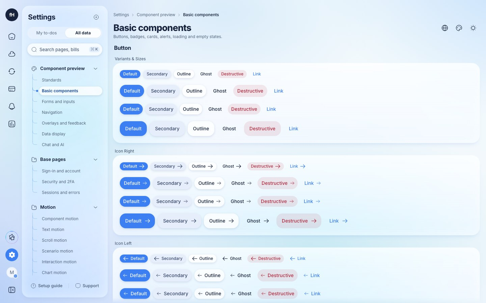<br>Basic component examples.</td>
  </tr>
  <tr>
    <td>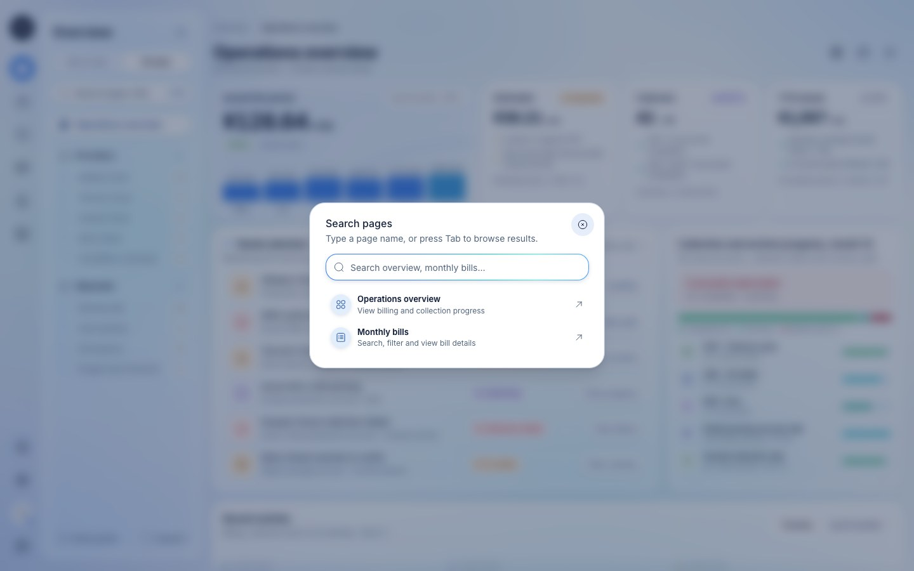<br>Command palette and navigation search.</td>
    <td>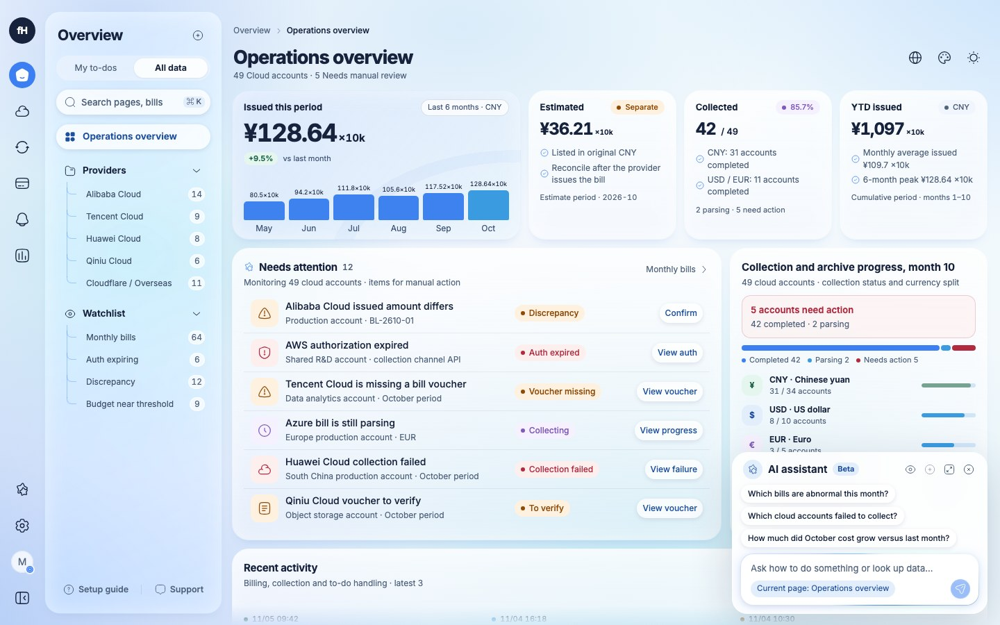<br>Copilot panel with suggested questions.</td>
  </tr>
  <tr>
    <td>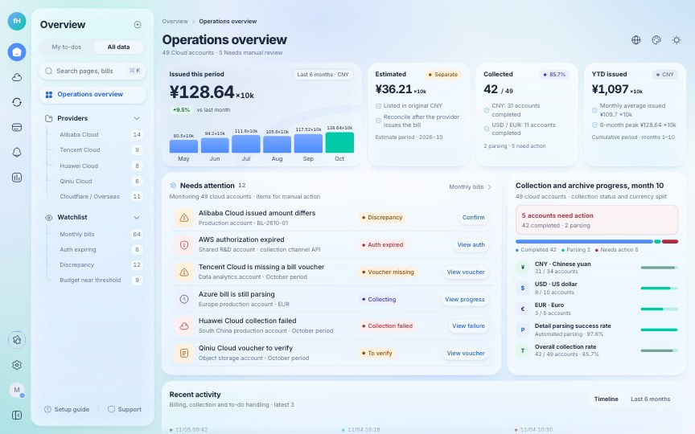<br>Overview in Telemedicine blue.</td>
    <td>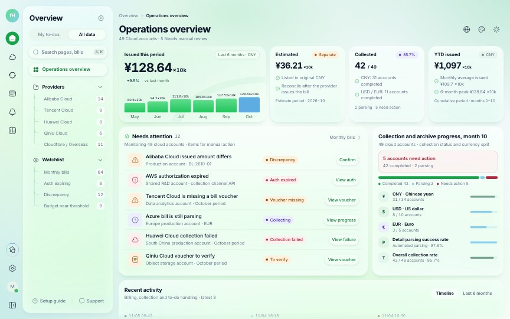<br>Overview in Fresh grass green.</td>
  </tr>
  <tr>
    <td colspan="2" align="center">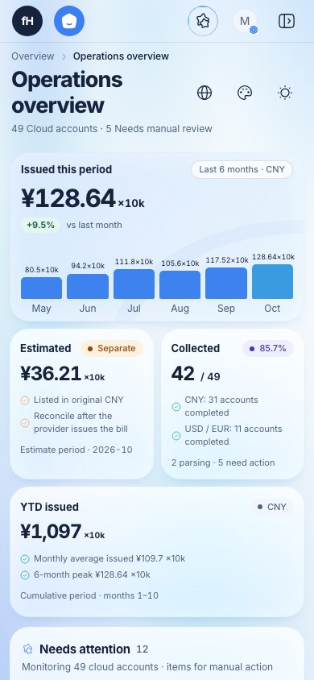<br>Overview at 390 px with the navigation drawer closed.</td>
  </tr>
</table>

## Quick start

Use Node.js 24 and pnpm 12.16.1. [Install Playwright Chromium](#playwright-reports-that-the-browser-executable-does-not-exist) before running UI tests or generating screenshots for the first time.

```sh
# Clone the repository and enter it
git clone https://github.com/marismoon/aries.git
cd aries

# Install workspace dependencies
pnpm install

# Start Demo at http://localhost:5173 by default
pnpm dev
```

In a second terminal, start Starter from the repository root.

```sh
# Start Starter at http://localhost:5174 by default
pnpm dev:starter
```

Inside the workspace, apps consume the source of `@marismoon/ui` and `@marismoon/shell` directly; both packages are also published to npm under the `next` tag for projects outside this repository. [Versioning and releases](docs/VERSIONING.md)

## Project structure

```text
aries/
├── apps/
│   └── demo/          Full demo app
├── packages/
│   ├── ui/            Design system
│   ├── shell/         Workspace shell
│   ├── create-aries/  Create command (npm create @marismoon/aries)
│   └── config/        Shared tooling configuration
└── templates/
    └── starter/       Starter template
```

Demo and Starter use public exports from Shell and UI. Shell depends on UI. [Architecture](docs/ARCHITECTURE.md)

## Create an app from Starter

```sh
# New app under apps/ in this repository (names the package, picks ports, installs)
pnpm create:app my-app

# Standalone project outside the repository
npm create @marismoon/aries@next my-app
```

The generated project uses the same three-column shell as Demo. Write pages in `src/features/` and register routes and navigation in `src/app/workspace-modules.ts`. A layout contract protects the shell: `pnpm lint` and `pnpm test:ui` reject any code that changes the layout, including content written by AI assistants. See [Create an app](docs/STARTER.md).

## Commands

| Command | Purpose |
| --- | --- |
| `pnpm dev` | Start Demo |
| `pnpm dev:starter` | Start Starter |
| `pnpm create:app <name>` | Create an app under `apps/` from Starter |
| `pnpm build` | Build Demo and Starter |
| `pnpm typecheck` | Check workspace types |
| `pnpm lint` | Lint the source |
| `pnpm test` | Run Vitest unit tests |
| `pnpm test:coverage` | Run the Demo coverage task |
| `pnpm test:ui` | Run Demo UI tests and the Starter smoke and layout-contract tests |
| `pnpm test:consumer` | Verify the packed ui and shell outside the workspace: scaffold a Vite project with create-aries and run all its checks, then build a Next.js host (needs network) |
| `pnpm check:workspace` | Check workspace package boundaries and run each app's layout guard |
| `pnpm check:package` | Pack ui, shell and create-aries, check contents and metadata, and run publint and attw |
| `pnpm run audit` | Audit dependencies and fail on high or critical findings |
| `pnpm format` | Format TS and TSX with Prettier |
| `pnpm docs:screenshots` | Generate both Demo screenshot sets in the [screenshots directory](docs/assets/screenshots/) |

The screenshot script starts Demo on local port 4175 and stops it when the captures finish.

## Development and contributing

Contributors and AI assistants start with the same development contract. [Development contract](AGENTS.md)

Husky and lint-staged run Prettier and ESLint on staged TS and TSX files. Run the following checks from the repository root before opening a pull request. [CI workflow](.github/workflows/ci.yml)

```sh
# Check your changes
pnpm typecheck
pnpm lint
pnpm build
pnpm test
pnpm test:ui
pnpm check:workspace
pnpm run audit
```

## Troubleshooting

### Playwright reports that the browser executable does not exist

UI tests and the screenshot script use Playwright's Chromium build. Install the matching browser before your first run.

```sh
# Install Chromium for the workspace's Playwright version
pnpm --filter @marismoon/demo exec playwright install chromium
```

### A UI test port is already in use

Demo and Starter UI tests use ports 4173 and 4174, respectively. If an older test server still owns the port, stop it and rerun the tests.

```sh
# Rerun after freeing the test port
pnpm test:ui
```

## Documentation

- [Architecture](docs/ARCHITECTURE.md) · [Tech stack](docs/TECH_STACK.md) · [Design system](docs/DESIGN_SYSTEM.md)
- [UI components](docs/COMPONENTS.md) · [Shell API and CSS variables](packages/shell/README.md) · [Internationalization](docs/I18N.md)
- [Create an app from Starter](docs/STARTER.md) · [Versioning and releases](docs/VERSIONING.md) · [Architecture decisions](docs/decisions/)
- [Development contract](AGENTS.md) · [CI workflow](.github/workflows/ci.yml)

## Environment variables

`VITE_API_BASE_URL` is a placeholder for connecting Demo to a real backend. You can run Demo with its current mock data without setting it. [Example environment file](.env.example)

## License

The code in this repository is released under the [MIT License](LICENSE). Bundled Solar icons are licensed under CC BY 4.0; shadcn/ui code, fonts and other third-party content follow their own licenses. See [Third-party notices](THIRD_PARTY_NOTICES.md).
