<p align="center">
  
</p>

<h1 align="center">Aries</h1>

<p align="center">React 工作区框架，包含设计系统、应用外壳、完整 Demo 和起步模板。</p>

<p align="center"><strong>简体中文</strong> | <a href="README.en.md">English</a></p>

<p align="center">
  <a href="https://github.com/marismoon/aries/actions/workflows/ci.yml"></a>
  
  
  
  
  
  
</p>

<p align="center">
  <a href="#快速开始">快速开始</a> ·
  <a href="#文档">文档</a> ·
  <a href="docs/ARCHITECTURE.md">架构</a> ·
  <a href="docs/STARTER.md">从 Starter 创建应用</a> ·
  <a href="AGENTS.md">开发契约</a>
</p>

| 亮色总览 | 暗色总览 |
| --- | --- |
| 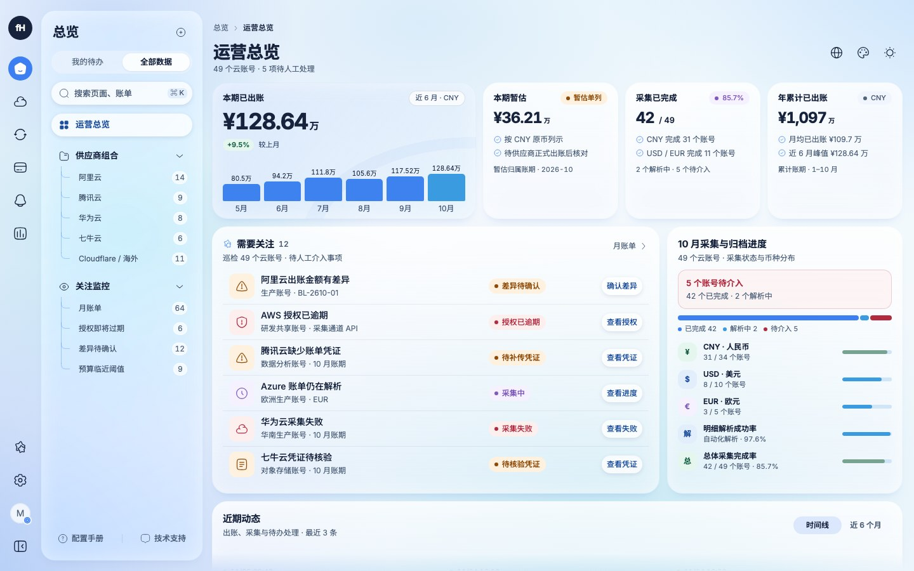 | 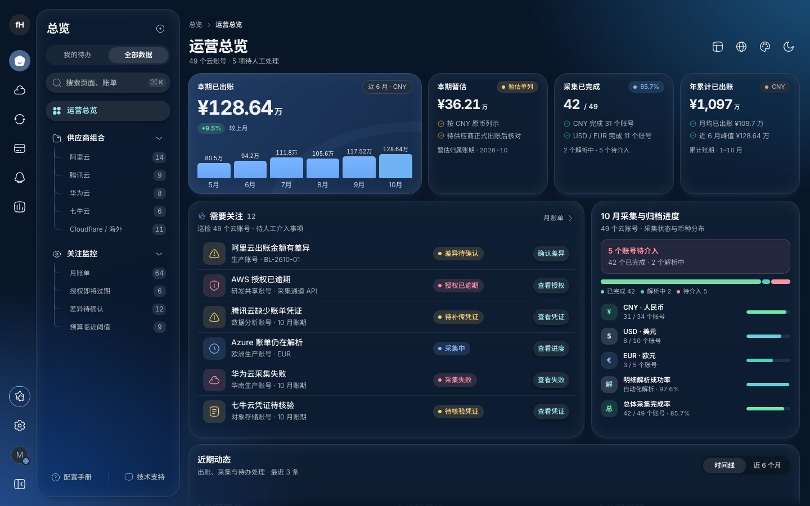 |

默认品牌主题下的 Demo 总览，左侧为亮色，右侧为暗色 glass。

## 简介与特性

Aries 提供构建工作区应用所需的共享组件和外壳。Demo 使用本地模拟数据展示概览、账单和组件，Starter 则提供接好外壳的首页与设置页。

- **品牌主题**。内置九套品牌主题，可从页头轮换。Aries 浅色海渊仅在亮色模式下可选。
- **明暗与材质**。支持亮色与暗色，暗色提供 glass 和 clean 两种材质。
- **组件与图标**。使用基于 shadcn 的组件与 Solar 图标，Demo 提供组件预览。
- **表格与图表**。使用 TanStack Table 展示账单数据，使用 Recharts 展示指标趋势。
- **工作区外壳**。三列布局包含模块入口、工作区导航和业务内容，命令面板可查找当前模块的页面，并打开可用条目。
- **中英双语**。工作区外壳和主要 Demo 页面支持简体中文与英文。
- **Copilot 示例**。右栏助手基于本地模拟数据回答示例问题。
- **Starter**。复制带首页和设置页的模板，在同一工作区开发新应用。

## 预览

<table>
  <tr>
    <td>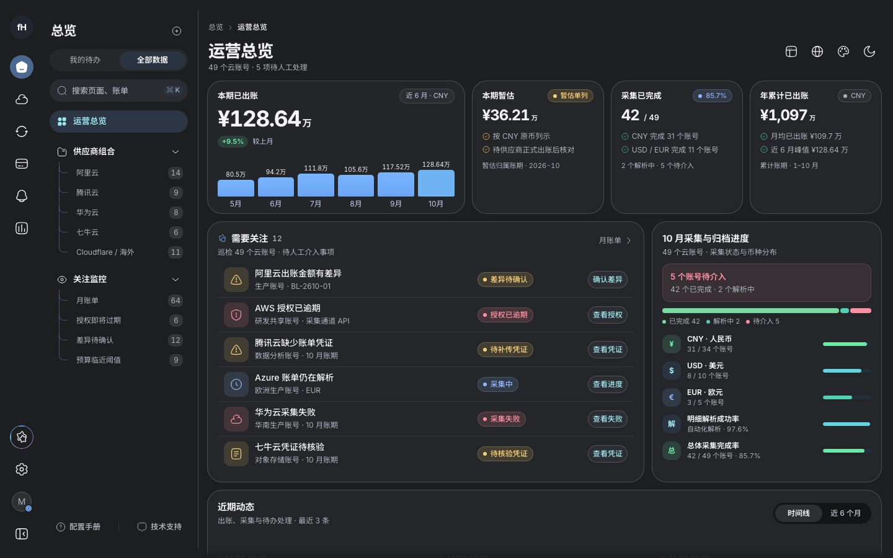<br>简洁暗色总览。</td>
    <td>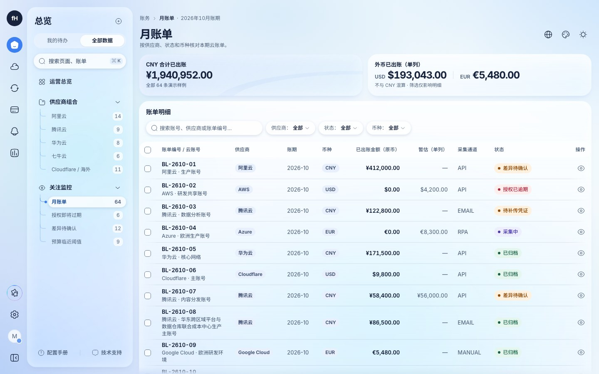<br>月账单与 TanStack 数据表。</td>
  </tr>
  <tr>
    <td>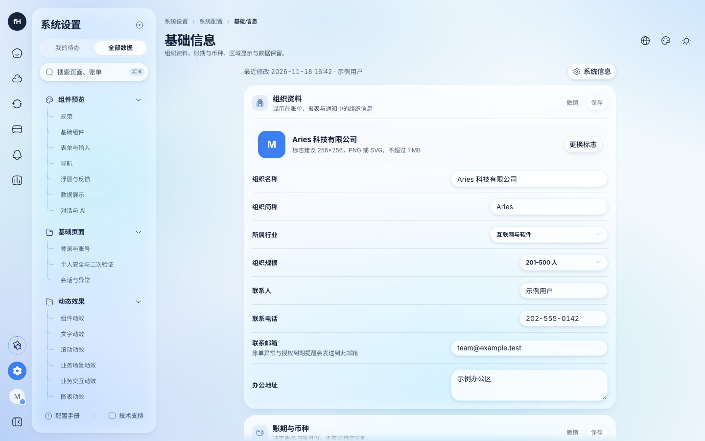<br>基本信息设置。</td>
    <td>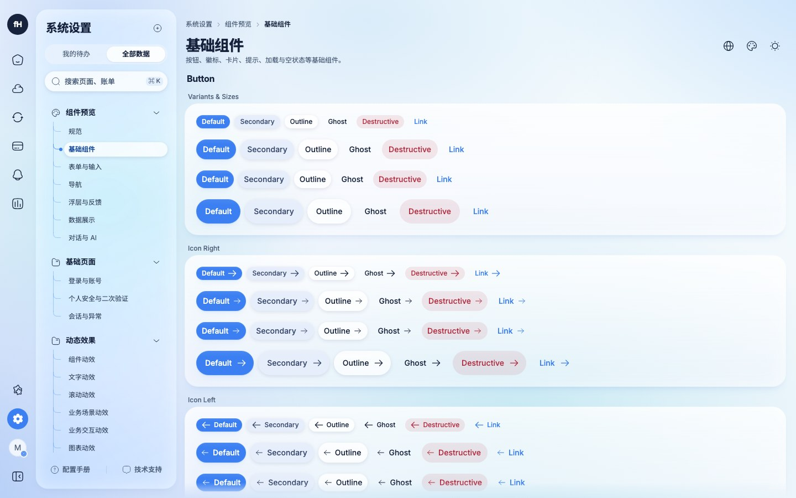<br>基础组件预览。</td>
  </tr>
  <tr>
    <td>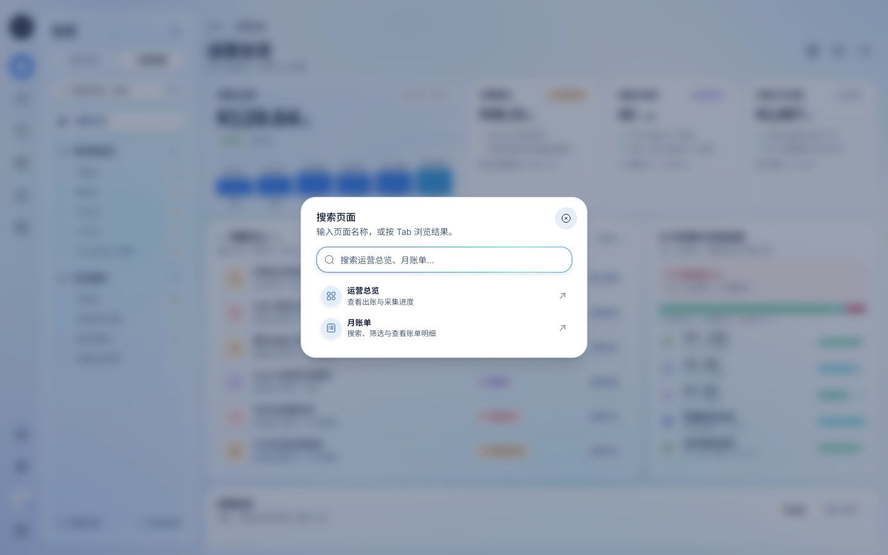<br>命令面板与导航搜索。</td>
    <td>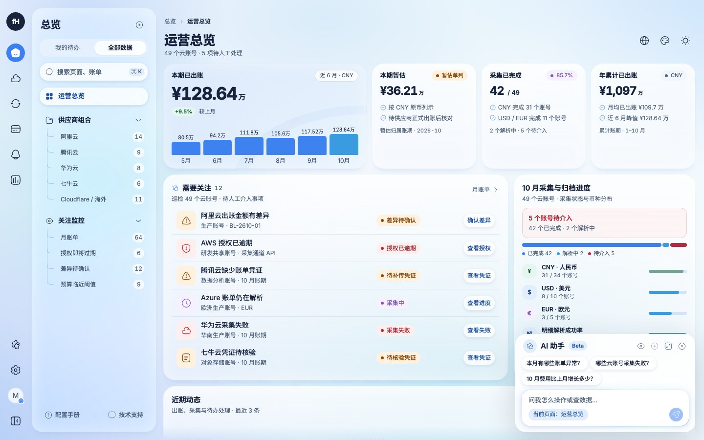<br>Copilot 右栏与示例问题。</td>
  </tr>
  <tr>
    <td>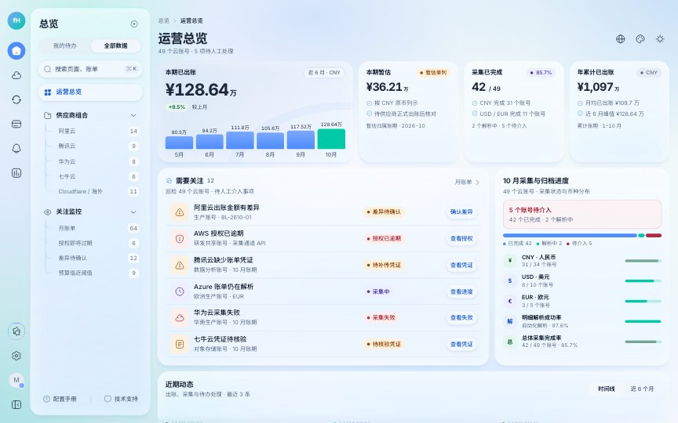<br>远程医疗蓝下的总览。</td>
    <td>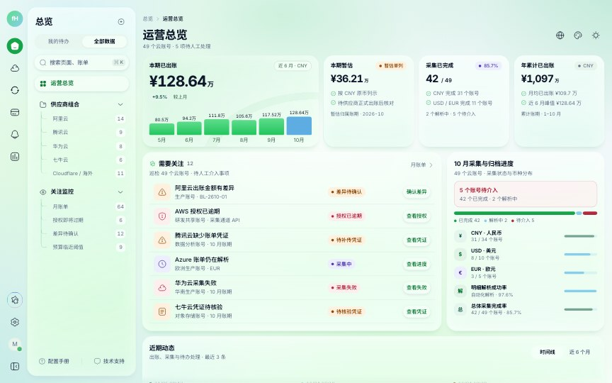<br>清新草绿下的总览。</td>
  </tr>
  <tr>
    <td>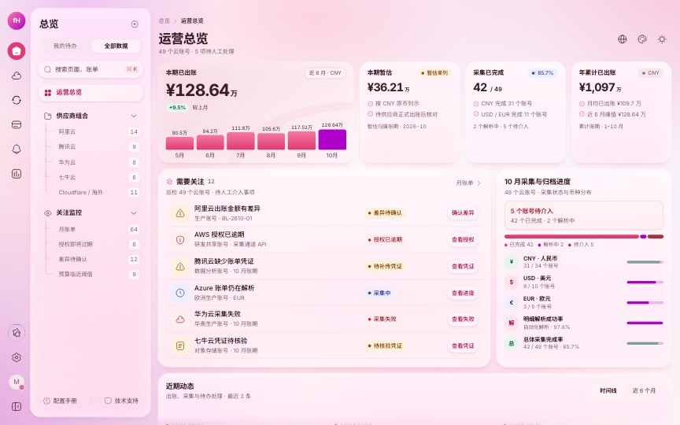<br>玫瑰石英下的总览。</td>
    <td align="center"><br>390 px 视口的总览，导航抽屉收起。</td>
  </tr>
</table>

## 快速开始

需要 Node.js 24 和 pnpm 12.16.1。首次运行 UI 测试或生成截图前，请[安装 Playwright Chromium](#playwright-找不到浏览器可执行文件)。

```sh
# 克隆仓库并进入项目目录
git clone https://github.com/marismoon/aries.git
cd aries

# 安装工作区依赖
pnpm install

# 启动 Demo，默认地址为 http://localhost:5173
pnpm dev
```

另开一个终端，从仓库根目录启动 Starter。

```sh
# 启动 Starter，默认地址为 http://localhost:5174
pnpm dev:starter
```

阶段一采用同仓源码消费。`@aries/ui` 和 `@aries/shell` 尚未发布到 npm。 [版本治理与阶段边界](docs/VERSIONING.md)

## 项目结构

```text
aries/
├── apps/
│   └── demo/          完整 Demo
├── packages/
│   ├── ui/            设计系统
│   ├── shell/         工作区外壳
│   └── config/        共享工程配置
└── templates/
    └── starter/       起步模板
```

Demo 与 Starter 使用 Shell 和 UI 的公开入口，Shell 依赖 UI。 [架构](docs/ARCHITECTURE.md)

## 基于 Starter 创建应用

1. 将 `templates/starter` 复制到 `apps/` 下的新目录。
2. 修改工作区包名，为开发服务和 Playwright 测试分配可用端口。
3. 添加页面组件和中英文资源。
4. 在工作区模块注册表登记路由与导航。

复制命令和完整接线见[从 Starter 创建应用](docs/STARTER.md)。

## 常用命令

| 命令 | 用途 |
| --- | --- |
| `pnpm dev` | 启动 Demo |
| `pnpm dev:starter` | 启动 Starter |
| `pnpm build` | 构建 Demo 与 Starter |
| `pnpm typecheck` | 检查工作区类型 |
| `pnpm lint` | 检查源码规则 |
| `pnpm test` | 运行 Vitest 单测 |
| `pnpm test:coverage` | 运行 Demo 的覆盖率任务 |
| `pnpm test:ui` | 运行 Demo 的 UI 测试和 Starter 冒烟测试 |
| `pnpm check:workspace` | 检查工作区包边界 |
| `pnpm run audit` | 审计依赖，高危及以上问题使检查失败 |
| `pnpm format` | 用 Prettier 格式化 TS 和 TSX |
| `pnpm docs:screenshots` | 生成中英文 Demo 截图，写入[截图目录](docs/assets/screenshots/) |

截图脚本会在本机 4175 端口启动 Demo，并在截图完成后关闭服务。

## 开发与贡献

贡献者与 AI 助手从同一份开发契约开始。 [开发契约](AGENTS.md)

Husky 和 lint-staged 对暂存的 TS、TSX 运行 Prettier 和 ESLint。提交 PR 前从仓库根目录运行以下检查。 [CI 工作流](.github/workflows/ci.yml)

```sh
# 检查当前改动
pnpm typecheck
pnpm lint
pnpm build
pnpm test
pnpm test:ui
pnpm check:workspace
pnpm run audit
```

## 故障排查

### Playwright 找不到浏览器可执行文件

UI 测试和截图脚本使用 Playwright 安装的 Chromium。首次运行前安装对应版本。

```sh
# 安装仓库锁定的 Playwright 所对应的 Chromium
pnpm --filter @aries/demo exec playwright install chromium
```

### UI 测试端口已被占用

Demo 和 Starter 的 UI 测试分别使用 4173 和 4174。确认并关闭占用端口的旧测试服务后，重跑测试。

```sh
# 释放测试端口后重跑
pnpm test:ui
```

## 文档

- [架构](docs/ARCHITECTURE.md) · [技术栈](docs/TECH_STACK.md) · [设计系统](docs/DESIGN_SYSTEM.md)
- [UI 组件](docs/COMPONENTS.md) · [Shell API 与 CSS 变量](packages/shell/README.md) · [国际化](docs/I18N.md)
- [从 Starter 创建应用](docs/STARTER.md) · [版本治理与阶段边界](docs/VERSIONING.md) · [架构决策](docs/decisions/)
- [开发契约](AGENTS.md) · [CI 工作流](.github/workflows/ci.yml)

## 环境变量

`VITE_API_BASE_URL` 是将 Demo 模拟服务接入真实后端时使用的占位变量。运行当前 Demo 无需填写。 [环境变量示例](.env.example)
